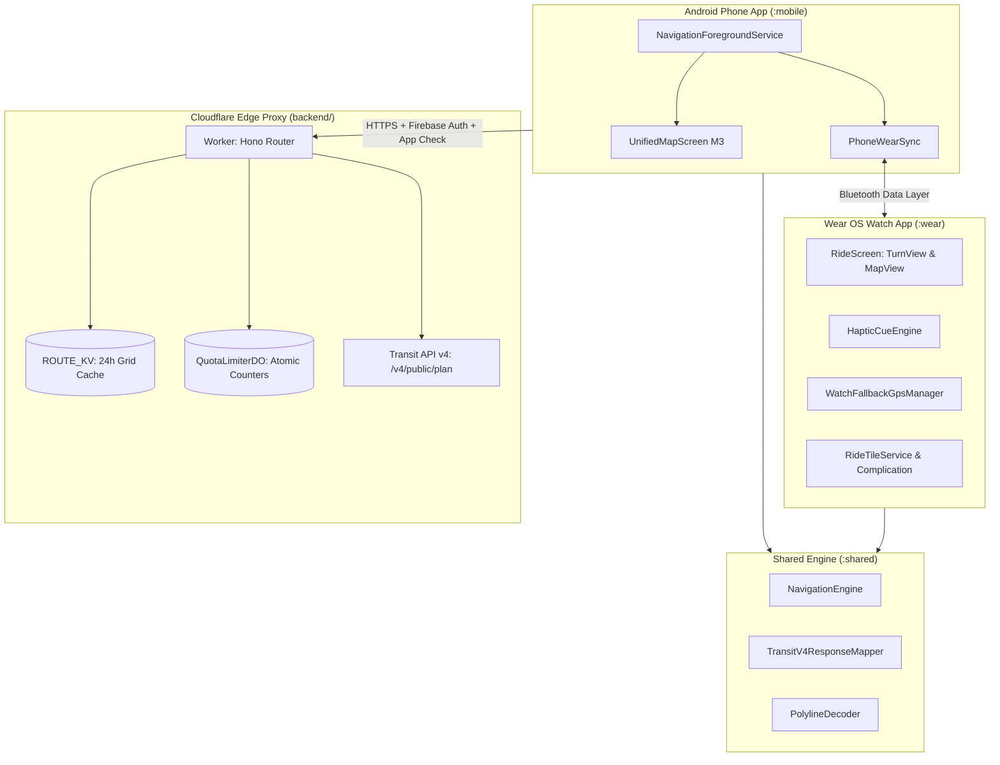

# Transit Bike Navigator: Project Status & Developer Handoff Guide

> **Current Commit**: `774b3f6` (Branch: `main`)  
> **Repository**: [https://github.com/cmoronta/transit.git](https://github.com/cmoronta/transit.git)  
> **Last Updated**: November 2026

This document is the **single source of truth** for picking up development on a new computer, onboarding a collaborator, or continuing with another AI agent.

---

## 1. Project Overview & Architecture

Transit Bike Navigator is a turn-by-turn bicycle navigation system consisting of:
1. **Cloudflare Worker Edge Proxy (`backend/`)**: Acts as a secure, authenticated shield in front of the Transit API v4 (`GET /v4/public/plan`). Keeps `TRANSIT_API_KEY` completely off client devices, enforces rate limits and quotas via a Cloudflare Durable Object (`QuotaLimiterDO`), and caches route calculations globally for 24 hours via Cloudflare KV (`ROUTE_KV`).
2. **Shared Kotlin Navigation Engine (`shared/`)**: Pure Kotlin JVM module shared by both phone and watch. Handles Transit v4 JSON parsing, safety sorting, polyline encoding/decoding, spherical geometry, maneuver cue evaluation (200m / 50m / 15m), and off-route reroute state machines.
3. **Android Phone Companion App (`mobile/`)**: Material 3 Expressive Android app featuring a Google Maps-inspired single-pane `UnifiedMapScreen` with a 3-stop `BottomSheetScaffold`, persistent `NavigationForegroundService`, Bluetooth sync via Google Play Services Wearable Data Layer, and an admin diagnostics sheet gated by Firebase custom claims (`admin: true`).
4. **Wear OS Watch App (`wear/`)**: Wear OS 4+ (API 33+) standalone app featuring Wear Compose Material 3 with system dynamic color extraction, toggleable `TurnView` and `MapView`, distinct haptic vibration cues (`HapticCueEngine`), autonomous watch GPS fallback if the phone disconnects, a ProtoLayout glanceable Tile (`RideTileService`), and a Watch Face Complication (`EtaComplicationService`).



---

## 2. Current Implementation Status

All core modules are implemented, tested, and pushed to `main`:

| Module | Status | Highlights |
| :--- | :---: | :--- |
| **`backend/`** | ✅ Complete | Modular Hono router, `jose` RS256 JWKS verification, Zod query validation, `QuotaLimiterDO` atomic rate limiting (4/min, 40/day, 1480/month), 24h KV cache, 7/7 Vitest tests passing. |
| **`shared/`** | ✅ Complete | `@Serializable` DTOs matching Transit OpenAPI 3.1.0 schema, `TransitV4ResponseMapper` sorting by `protected_lanes_percentage` descending (`Safest · Default ★` first), `PolylineDecoder`, `NavigationEngine`, `UnitFormatter`, `DataLayerContract`, 6 JUnit test suites. |
| **`mobile/`** | ✅ Complete | Edge-to-edge Compose single-pane layout, 3-stop drawer (Peek / Half / Full), `NavigationForegroundService` with notification, `WorkerProxyApi` + `AuthManager`, `AdminDiagnosticsSheet` (gated by `admin: true`), offline Atlanta test route fallback. |
| **`wear/`** | ✅ Complete | Wear Compose M3 with `dynamicColorScheme`, toggleable `TurnView` & `MapView`, `HapticCueEngine` (distinct waveforms for 200m / 50m / 15m), `WatchFallbackGpsManager` (6s phone heartbeat timeout), ProtoLayout M3 `RideTileService`, `EtaComplicationService`. |

---

## 3. Setting Up on a New Computer

### Prerequisites
1. **Operating System**: macOS, Linux, or Windows (with WSL2).
2. **Git**: Configured with GitHub access (`git clone https://github.com/cmoronta/transit.git`).
3. **Node.js**: v20+ and npm (v10+).
4. **Android Development**:
   - **Android Studio**: Ladybug (2024.2.1) or newer.
   - **JDK**: Java 17 (recommended: Android Studio bundled JDK or Azul Zulu 17).
   - **Android SDK**:
     - Android 15 (API 35) SDK platform and sources.
     - Android SDK Build-Tools 35.0.0.
     - Android SDK Platform-Tools (`adb`).
5. **Physical Devices (or Emulators)**:
   - **Phone**: Android 8.0+ (API 26+) phone with developer mode & USB debugging enabled.
   - **Watch**: Wear OS 4+ (API 33+) smartwatch (e.g. Pixel Watch 1/2/3, Galaxy Watch 4/5/6/7) paired with the phone.

---

### Step-by-Step Setup

#### Step 1: Clone Repository
```bash
git clone https://github.com/cmoronta/transit.git
cd transit
```

#### Step 2: Backend Setup & Verification
```bash
cd backend
npm install

# Run backend unit tests (Vitest)
npm test

# Type-check without emit
npx tsc --noEmit
```

To run the local Cloudflare Worker development server with Miniflare:
```bash
# Create local development variables file (gitignored)
cp .dev.vars.example .dev.vars

# Add your TRANSIT_API_KEY into .dev.vars, then run:
npm run dev
```

#### Step 3: Android Studio Setup
1. Launch **Android Studio**.
2. Select **Open** $\to$ choose the root folder `/path/to/transit`.
3. Let Gradle sync automatically. Gradle uses the wrapper:
   - Android Gradle Plugin: `8.7.3`
   - Kotlin: `2.1.0`
   - Target SDK: `35` (Android 15)
   - JDK: `17`
4. If Android Studio prompts for JDK location, set it to JDK 17 (e.g. `Settings -> Build, Execution, Deployment -> Build Tools -> Gradle -> Gradle JDK`).

---

## 4. Testing & Running on Devices

### Running the App on Physical Devices

#### A. Phone (`:mobile`):
1. Connect your Android phone via USB cable (or Wireless Debugging).
2. Ensure `adb devices` lists your phone.
3. In Android Studio, select the **`mobile`** run configuration in the top toolbar.
4. Click **Run (▶)**.
5. The app launches with the **Atlanta Midtown $\to$ Ponce City Market** test route pre-loaded.
6. Grant Location and Notification permissions when prompted.
7. Tap **"Start Ride"**:
   - The persistent notification appears in your status bar.
   - The top turn banner displays upcoming maneuvers and distances.
   - The speedometer tracks active speed.

#### B. Watch (`:wear`):
1. Connect your Wear OS watch via Wireless Debugging:
   - Watch: *Settings $\to$ Developer options $\to$ Wireless debugging $\to$ Pair new device*.
   - Computer: `adb pair <watch_ip>:<pair_port> <pairing_code>`.
   - Computer: `adb connect <watch_ip>:<connect_port>`.
2. Ensure `adb devices` shows your watch.
3. In Android Studio, select the **`wear`** run configuration.
4. Click **Run (▶)**.
5. With both apps running:
   - Starting a ride on the phone automatically pushes the active route and turns to the watch.
   - The watch switches to `RideScreen` with `TurnView`.
   - Tap the bottom **"Map"** button to view the route polyline.
   - Approaching turns triggers wrist vibrations via `HapticCueEngine`.
   - Disconnecting Bluetooth for $> 6$ seconds causes the watch to automatically engage its internal GPS.

---

## 5. Key Design Decisions & Code References

### 1. Zero API Keys on Mobile / Watch
- The client apps never store or transmit `TRANSIT_API_KEY`.
- All requests proxy through Cloudflare Worker [`backend/src/controllers/plan.ts`](file:///Users/cmoronta/Desktop/transit/backend/src/controllers/plan.ts).
- Upstream client service: [`backend/src/services/transit.ts`](file:///Users/cmoronta/Desktop/transit/backend/src/services/transit.ts).

### 2. Safety-First Bike Route Sorting
- Querying Transit v4 (`mode=personal_bike`, `should_include_safety=true`, `num_result=3`) returns up to 3 routes with safety analysis.
- [`TransitV4ResponseMapper`](file:///Users/cmoronta/Desktop/transit/shared/src/main/kotlin/com/transitbike/shared/nav/TransitV4ResponseMapper.kt) sorts routes by `protected_lanes_percentage` descending.
- The route with the highest percentage of protected bike lanes is always at index 0 and marked `isSafestDefault = true`.

### 3. Rate Limiting & Edge Caching
- **KV Cache**: [`backend/src/cache.ts`](file:///Users/cmoronta/Desktop/transit/backend/src/cache.ts) rounds coordinates to ~100m grid cells. Identical or nearby requests within 24 hours hit KV cache and consume **0 Transit API quota**.
- **Durable Object**: [`backend/src/quota-do.ts`](file:///Users/cmoronta/Desktop/transit/backend/src/quota-do.ts) acts as a singleton strongly consistent counter:
  - 4 requests / minute burst limit
  - 40 requests / day / user limit
  - 1,480 requests / month budget limit

### 4. Admin Diagnostics Gating
- The `/v1/admin/quota` endpoint and phone diagnostics sheet require Firebase custom claim `{ "admin": true }`.
- Script to set claim: [`backend/scripts/set-admin-claim.ts`](file:///Users/cmoronta/Desktop/transit/backend/scripts/set-admin-claim.ts).
- Middleware: [`backend/src/middleware/auth.ts`](file:///Users/cmoronta/Desktop/transit/backend/src/middleware/auth.ts).
- Mobile UI: [`mobile/src/main/kotlin/com/transitbike/mobile/ui/AdminDiagnosticsSheet.kt`](file:///Users/cmoronta/Desktop/transit/mobile/src/main/kotlin/com/transitbike/mobile/ui/AdminDiagnosticsSheet.kt).

### 5. Navigation State Machine & Cues
- [`NavigationEngine`](file:///Users/cmoronta/Desktop/transit/shared/src/main/kotlin/com/transitbike/shared/nav/NavigationEngine.kt):
  - **Approach Cue**: Distance $\le 200\text{ m}$ (and $> 50\text{ m}$).
  - **Prepare Cue**: Distance $\le 50\text{ m}$ (and $> 15\text{ m}$).
  - **Turn Now Cue**: Distance $\le 15\text{ m}$.
  - Each cue is deduplicated and fires at most once per maneuver.
  - **Off-route**: $> 40\text{ m}$ deviation for $\ge 15$ continuous seconds.
  - **Reroute Cooldown**: Max 1 reroute per 20 seconds, capped at 10 reroutes per trip.
  - **Arrival**: $\le 25\text{ m}$ from destination.

### 6. Haptic Vibration Patterns
- [`HapticCueEngine`](file:///Users/cmoronta/Desktop/transit/wear/src/main/kotlin/com/transitbike/wear/nav/HapticCueEngine.kt):
  - `APPROACH_200M`: Gentle double-tap (80ms on, 120ms off, 80ms on).
  - `PREPARE_50M`: Firm ramp-up (120ms on, 80ms off, 180ms on).
  - `NOW_15M`: Sharp triple pulse (100ms on, 50ms off, 100ms on, 50ms off, 180ms on).

---

## 6. Next Steps Checklist (When Resuming)

When you're ready to deploy to production or connect live services:

- [ ] **Cloudflare Worker Deployment**:
  - Log in via `npx wrangler login`.
  - Create KV namespace: `npx wrangler kv:namespace create ROUTE_KV`.
  - Update `id` in `backend/wrangler.toml`.
  - Set secret: `npx wrangler secret put TRANSIT_API_KEY`.
  - Deploy: `npm run deploy` inside `backend/`.
- [ ] **Firebase Authentication Setup**:
  - Create project in Firebase Console.
  - Download `google-services.json` and place in `mobile/`.
  - Enable Google Sign-In and Play Integrity App Check.
  - Grant admin claim to your UID: `npx tsx scripts/set-admin-claim.ts <YOUR_UID>`.
  - Update `FIREBASE_PROJECT_ID` and `FIREBASE_PROJECT_NUMBER` in `backend/wrangler.toml`.
- [ ] **MapLibre Style Customization**:
  - Currently using default OpenFreeMap OSM vector tiles. You can configure custom outdoor/cycling MapLibre JSON styles in `mobile/src/main/kotlin/com/transitbike/mobile/TransitBikeApplication.kt`.
- [ ] **Physical Field Test**:
  - Take the phone and watch out on the Atlanta BeltLine or your local cycletrack to verify real-world GPS accuracy, haptic timing, and AOD battery consumption.
