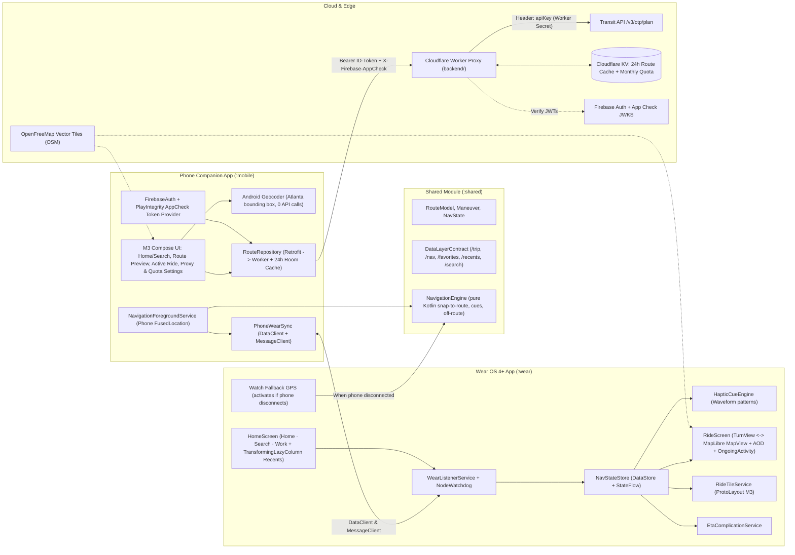

# Wear OS & Phone Companion Bike Navigator (Transit API + Cloudflare Worker Proxy): Architecture Plan

## Goal
Build a full **Wear OS 4+ (API 33+) watch app + Android phone companion app + Cloudflare Worker backend proxy** (`~/.gemini/antigravity/scratch/transit-bike-wear`) that delivers **turn-by-turn bike directions** on your wrist using **haptic vibration cues**, an **Always-On Display (AOD) Ride screen** (with toggleable **Turn View** and draggable/crown-zoomable **MapLibre + OpenFreeMap** map), a **Wear OS Tile**, and a **Watch Face Complication**.

### Finalized Design & Architecture Decisions
- **Zero API Keys on Any Device**:
  - Your Transit API key (`TRANSIT_API_KEY`) lives **exclusively in a Cloudflare Worker Secret** (`wrangler secret put TRANSIT_API_KEY`). Neither the watch APK nor the phone APK ever stores or sees the Transit API key.
  - **Authentication & Attestation**: The phone app authenticates to your Cloudflare Worker using **Firebase Auth** (`Authorization: Bearer <ID-Token>`, locked to your allowlisted UID) + **Firebase App Check with Play Integrity** (`X-Firebase-AppCheck` header, attesting that the request comes from your untampered Android app on a genuine Play-certified device). The Worker verifies both JWTs against Google's public JWKS endpoints before serving any request.
  - **Edge Caching & Quota Enforcement in Cloudflare KV**: The Worker normalizes `(fromPlace, toPlace)` to a ~100 m grid, caches bike routes in **Cloudflare KV** for 24 hours, enforces the **4 req/min** rate limit and **1,500 calls/month** budget in KV, and returns quota headers (`X-Quota-Used`, `X-Quota-Limit`, `X-Cache`) so the phone app can display live usage.
- **Design Workshops**:
  - Watch Tile & App Workshop: [tile_design_workshop.html](file:///Users/cmoronta/.gemini/antigravity/brain/54afc5b4-b1ec-448f-b0a4-69f66396ce25/tile_design_workshop.html)
  - Phone Companion App Workshop (Rev 2 — Cloud Proxy & App Check): [phone_design_workshop.html](file:///Users/cmoronta/.gemini/antigravity/brain/54afc5b4-b1ec-448f-b0a4-69f66396ce25/phone_design_workshop.html)
- **Map Stack**: **MapLibre Native for Android** (`org.maplibre.gl:android-sdk`) + **OpenFreeMap** vector tiles (`https://tiles.openfreemap.org/styles/liberty` / dark). Completely free, open-source OSM data, zero API keys required.
- **GPS Strategy (Phone → Watch Fallback)**:
  - **Primary**: Phone `FusedLocationProviderClient` (phone in pocket or mount) drives `NavigationEngine` to save watch battery.
  - **Fallback**: The full `RouteModel` is synced to the watch at ride start (`/nav/route`). Because `NavigationEngine` lives in `:shared`, if the watch loses Bluetooth connection (`CapabilityClient` / heartbeat timeout > 6 s), the watch automatically starts its own `FusedLocationProviderClient` and runs `NavigationEngine` locally until the phone reconnects.
- **Units**: Follow phone locale (`Locale.getDefault()` — US Imperial `mi`/`ft` by default in the US, `km`/`m` in metric locales), synced to the watch.
- **Default Region & Test Fixtures**: **Atlanta, GA** (Midtown, Eastside BeltLine Trail, Ponce City Market, Piedmont Park, Georgia Tech).
- **Rerouting**: Automatic reroute after **15 s** off-route (> 40 m from polyline), **max 1 per 20 s**, **max 10 per trip**.
- **Android 14+ Pocket Start**: Request `ACCESS_BACKGROUND_LOCATION` ("Allow all the time") on the phone companion app so tapping Home/Work/Recent on the watch Tile cleanly starts `NavigationForegroundService` with `foregroundServiceType="location"` while the phone stays locked in your pocket.

---

## User Review Required

> [!IMPORTANT]
> **Ready to Scaffold & Build**
> Once you approve this plan, I will scaffold the entire repository in `/Users/cmoronta/Desktop/transit` including:
> 1. `backend/` — The **Cloudflare Worker + KV** TypeScript project (with JWT verification for Firebase Auth & App Check, KV 24h route cache, KV monthly/per-minute quota guard, and Vitest unit tests).
> 2. `:shared`, `:mobile`, and `:wear` — The complete Android & Wear OS multi-module project and unit test suites.
>
> *(For Phase 0, you can either deploy the Worker with `wrangler secret put TRANSIT_API_KEY` and capture a live Atlanta response, or we will build against a realistic OTP v3 Atlanta BeltLine JSON fixture right away and plug in your live Worker URL in Settings.)*

---

## High-Level Architecture



---

## Proposed Project Structure & Component Details

Project root: `/Users/cmoronta/Desktop/transit`

```text
transit-bike-wear/
├── backend/                   # Cloudflare Worker + KV proxy (TypeScript + Wrangler + Vitest)
│   ├── wrangler.toml
│   ├── package.json
│   ├── src/
│   │   ├── index.ts           # /v1/plan & /v1/quota endpoints
│   │   ├── auth.ts            # Firebase Auth + Firebase App Check RS256 JWKS verifier
│   │   ├── quota.ts           # 4 req/min sliding window + 1,500/month KV counter
│   │   └── cache.ts           # ~100m grid coordinate normalizer + 24h KV route cache
│   └── test/
│       └── worker.test.ts
├── settings.gradle.kts
├── build.gradle.kts
├── gradle/libs.versions.toml
├── shared/                    # Kotlin library: models, DataLayerContract, PolylineDecoder, NavigationEngine
├── mobile/                    # Android phone companion app (minSdk 26, targetSdk 34)
└── wear/                      # Wear OS 4+ app (minSdk 33, targetSdk 34)
```

---

### 1. `backend/` Module (Cloudflare Worker + KV Proxy)

#### [NEW] `backend/src/auth.ts`
- Uses Web Crypto API (`crypto.subtle`) to verify two tokens on every request (caching Google's JWKS keys at the edge):
  1. `X-Firebase-AppCheck`: Verifies signature against `https://firebaseappcheck.googleapis.com/v1/jwks`, issuer `https://firebaseappcheck.googleapis.com/<PROJECT_NUMBER>`, and `aud` matching your Firebase project.
  2. `Authorization: Bearer <ID-Token>`: Verifies signature against Google SecureToken JWKS, issuer `https://securetoken.google.com/<PROJECT_ID>`, and checks that `sub` (UID) is in the Worker's `ALLOWED_UIDS` environment variable.

#### [NEW] `backend/src/cache.ts` & `backend/src/quota.ts`
- **Grid Cache**: Rounds `fromPlace` and `toPlace` lat/lon to 3 decimal places (~110 m) for cache key `route:v1:<fromGrid>:<toGrid>`. If found in `ROUTE_KV`, returns immediately with `X-Cache: HIT` and **0 Transit API calls**.
- **Quota Guard**:
  - Checks per-minute key `ratelimit:<epochMinute>` (max 4/min; returns `429 Too Many Requests` if exceeded).
  - Checks monthly key `quota:<YYYY-MM>` (soft warning header at 1,400, hard stop at 1,480 out of 1,500).
- **Upstream Proxy**: Calls `https://external.transitapp.com/v3/otp/plan` injecting `apiKey: env.TRANSIT_API_KEY`, caches the response in KV (`expirationTtl: 86400`), increments `quota:<YYYY-MM>`, and returns the response with `X-Quota-Used` and `X-Quota-Limit: 1500` headers.

---

### 2. `:shared` Module (Pure Navigation & Serialization Logic)

#### [NEW] `shared/src/main/kotlin/com/transitbike/shared/model/RouteModel.kt`
- `@Serializable` models for `RouteModel`, `LatLng`, `Maneuver`, `ManeuverType` (`LEFT`, `RIGHT`, `SLIGHT_LEFT`, `SLIGHT_RIGHT`, `STRAIGHT`, `U_TURN`, `ARRIVE`), `NavState`, `FavoritePlace`, `RecentRide`, `QuotaStatus`, and `UnitSystem` (`IMPERIAL`, `METRIC`).
- `UnitFormatter`: formats distances (`350 ft` / `0.6 mi` vs `110 m` / `950 m`) according to the active `UnitSystem` derived from `Locale.getDefault()`.

#### [NEW] `shared/src/main/kotlin/com/transitbike/shared/datalayer/DataLayerContract.kt`
| Path | API | Direction | Purpose |
|---|---|---|---|
| `/trip/start` | `MessageClient` | Watch → Phone | Start ride to `{favoriteId}` or `{lat, lon, label}` |
| `/trip/stop` | `MessageClient` | Both | Stop active navigation |
| `/nav/route` | `DataClient` | Phone → Watch | Full `RouteModel` so watch can render polyline & run fallback GPS |
| `/nav/cue` | `MessageClient` | Phone → Watch | Immediate haptic trigger `{maneuver, distanceM, threshold}` |
| `/nav/state` | `DataClient` | Phone → Watch | Throttled state (`distToNextM`, `etaEpochMs`, `remainingM`, `status`) |
| `/favorites` | `DataClient` | Phone → Watch | Home & Work coordinates + cached duration/distance |
| `/recents` | `DataClient` | Phone → Watch | Recent rides list for `HomeScreen` scroll |
| `/search/query` & `/search/results` | `MessageClient` | Watch ↔ Phone | Voice/keyboard search on watch geocoded by phone |

#### [NEW] `shared/src/main/kotlin/com/transitbike/shared/nav/NavigationEngine.kt`
- Snaps GPS fixes to the active route polyline using a forward-biased segment window.
- Fires `Cue` events once per maneuver at **200 m (~650 ft)**, **50 m (~160 ft)**, and **15 m ("Now")**.
- Detects **off-route** (> 40 m from polyline continuously for 15 s) and triggers `RerouteRequest` if within rate limits (≥ 20 s since last reroute, < 10 reroutes this trip).

---

### 3. `:mobile` Module (Phone Companion App)

#### [NEW] `mobile/src/main/kotlin/com/transitbike/mobile/api/WorkerProxyApi.kt` & `FirebaseHeaderInterceptor.kt`
- OkHttp interceptor fetches a fresh Firebase ID Token (`FirebaseAuth.getInstance().currentUser.getIdToken(false)`) and App Check Token (`FirebaseAppCheck.getInstance().getAppCheckToken(false)`) and attaches them to requests to your Cloudflare Worker (`https://<your-worker>.workers.dev/v1/plan`).
- Reads `X-Quota-Used` and `X-Cache` response headers to update the local quota state displayed in Settings.

#### [NEW] `mobile/src/main/kotlin/com/transitbike/mobile/data/RouteRepository.kt`
- Checks local Room cache for `(originGrid100m, destGrid100m)` younger than 24 hours before calling `WorkerProxyApi` (which itself has the 24h Cloudflare KV cache).
- Parses **all alternative `plan.itineraries`** returned by Transit's OTP planner into a `List<RouteModel>`, computing each route's `protectedBikePct` (percentage of total distance on dedicated cycletracks, greenways, and separated bike paths vs shared roads) and **sorting the list by `protectedBikePct` descending** so the **safest / highest-% protected route is always selected by default (`index = 0`)**.

#### [NEW] `mobile/src/main/kotlin/com/transitbike/mobile/nav/NavigationForegroundService.kt`
- Runs with `foregroundServiceType="location"` while a trip is active.
- Subscribes to `FusedLocationProviderClient` (1 Hz high accuracy), feeds `NavigationEngine`, and dispatches `/nav/cue` and `/nav/state` to `:wear`.

#### [NEW] `mobile/src/main/kotlin/com/transitbike/mobile/ui/*` (Single-Pane Unified Google Maps Flow)
As mocked up in Revision 5 of [phone_design_workshop.html](file:///Users/cmoronta/.gemini/antigravity/brain/54afc5b4-b1ec-448f-b0a4-69f66396ce25/phone_design_workshop.html):
- **Single Persistent Map Canvas (`UnifiedMapScreen.kt`)**: No bottom navigation bar and zero API/cache/proxy jargon in the rider UI. A single persistent MapLibre + OpenFreeMap Atlanta canvas stays mounted at all times while the top overlay and a **3-stop (`Peek` / `Half` / `Full Screen`) M3 `BottomSheetScaffold`** morph across three states:
  1. **`Explore` (Idle)**: Floating M3 `SearchBar` (with embedded `⌚ 88%` watch status pill), quick filter chips (*Home*, *Work*, *Bike Lanes* toggle), Snap-Map-style clickable place pills on the map, and a bottom drawer with Home/Work shortcuts and Recent Destinations that can be pulled all the way up to **Full Screen**.
  2. **`RoutePreview` (Multi-Route Picker, Safest Default)**:
     - **Top Overlay**: Clean Google Maps **Origin → Destination header card** (`Your location → Destination` with `←` back button).
     - **Map**: Draws **all alternative routes** returned by the API simultaneously — unselected alternatives as muted dashed polylines and the selected route as a bold highlighted polyline, each with a tappable floating callout bubble (`14 min · 92% protected ★`).
     - **Bottom Drawer (Pullable to Full Screen)**: Displays selectable route option cards sorted with the **highest % protected bike path selected by default (`Safest · Default ★`)**, followed by the primary *"⌚ Start Ride on Watch"* button and the turn-by-turn steps for the selected route.
  3. **`ActiveRiding`**: Camera follows the rider beacon on the *same* map; top overlay morphs into a Google Maps-style green turn banner; bottom drawer defaults to a compact ETA + *"Exit"* trip bar (and can be pulled up to Half or Full Screen to inspect all remaining turns).
- **Hidden Admin / Developer Diagnostics Sheet (`AdminDiagnosticsSheet.kt`)**: Accessible only to you by tapping/long-pressing the watch status pill in debug/admin mode — displays Cloudflare Worker KV monthly quota (`X / 1,500`), Firebase App Check status, cache hit rate, and the *Wrist Haptic Preview Studio* for testing watch vibrations.

---

### 4. `:wear` Module (Wear OS 4+ App, Tile & Complication)

#### [NEW] `wear/src/main/kotlin/com/transitbike/wear/sync/WearListenerService.kt` & `WatchFallbackGpsManager.kt`
- Receives `/nav/route`, `/nav/state`, `/nav/cue`, `/favorites`, and `/recents`.
- Monitors phone connection via `CapabilityClient` and heartbeats; if disconnected for > 6 s during an active ride, starts watch `FusedLocationProviderClient` and feeds `:shared`'s `NavigationEngine` locally on the watch until the phone reconnects.

#### [NEW] `wear/src/main/kotlin/com/transitbike/wear/haptics/HapticCueEngine.kt`
- `VibrationEffect.createWaveform` patterns:
  - **Left**: 2 crisp pulses (intensity scales at 200 m → 50 m → Now).
  - **Right**: 1 long pulse (intensity scales at 200 m → 50 m → Now).
  - **Continue / Slight**: 1 soft tick.
  - **Off-route**: 3 rapid strong buzzes.
  - **Arrived**: Celebratory rising ramp.

#### [NEW] `wear/src/main/kotlin/com/transitbike/wear/ui/home/WearHomeScreen.kt`
- Matches the [watch workshop](file:///Users/cmoronta/.gemini/antigravity/brain/54afc5b4-b1ec-448f-b0a4-69f66396ce25/tile_design_workshop.html): `TransformingLazyColumn` with *"Ride to"* header, **Home · Search · Work** M3 button group (Search is larger filled primary button launching `RemoteInput`), bouncing chevron, and **Recent trips** tonal buttons below.

#### [NEW] `wear/src/main/kotlin/com/transitbike/wear/ui/ride/RideScreen.kt`
- **Turn View ↔ Map View** toggled via bottom M3 `EdgeButton`.
- **Map View**: MapLibre `MapView` rendering OpenFreeMap vector tiles + route `Polyline` + rider heading chevron + top next-turn pill. Dragging pans and shows a recenter button; rotating the watch crown zooms (`onRotaryScrollEvent`).
- **Always-On Display (AOD) & `OngoingActivity`**: `AmbientLifecycleObserver` switches both views into low-bit/outlined ambient rendering with burn-in pixel shifting, while `OngoingActivity` keeps `RideScreen` pinned over the watch face throughout the ride.

#### [NEW] `wear/src/main/kotlin/com/transitbike/wear/tile/RideTileService.kt` & `EtaComplicationService.kt`
- M3 ProtoLayout Tile supporting all 5 states from the workshop (**Idle**, **Navigating** with dynamic-time ETA countdown, **Off-route**, **Arrived**, **Phone disconnected**).
- `SHORT_TEXT` & `RANGED_VALUE` watch-face complication for ETA and trip progress.

---

## Verification Plan

### Automated Tests
- **Cloudflare Worker (`backend/`)**:
  - `npm test` (Vitest): Tests JWT auth rejection on missing/invalid App Check or non-allowlisted UID, KV cache hit returning 0 upstream calls, 4 req/min rate limiter (`429`), and 1,500/month quota enforcement.
- **Android Modules (`:shared`, `:mobile`, `:wear`)**:
  - `./gradlew :shared:test`: `PolylineDecoderTest`, `OtpResponseMapperTest` (against the Atlanta BeltLine OTP JSON fixture), `NavigationEngineTest` (200 m / 50 m / Now cue triggers, 15 s off-route detection, 20 s reroute cooldown, phone→watch handover continuity), and `UnitFormatterTest`.
  - `./gradlew :mobile:testDebugUnitTest`: `RouteRepositoryTest` (Room cache hit vs Worker proxy call + quota header parsing).
  - `./gradlew :wear:testDebugUnitTest`: `HapticCueEngineTest` & Data Layer payload serialization round-trips.

### Manual Verification
1. Deploy the Cloudflare Worker (`cd backend && npx wrangler secret put TRANSIT_API_KEY && npx wrangler deploy`).
2. Open `/Users/cmoronta/Desktop/transit` in Android Studio, pair Phone + Wear OS 4 emulators, sign in on the phone app, and verify a simulated GPX bike ride along the Atlanta BeltLine.
