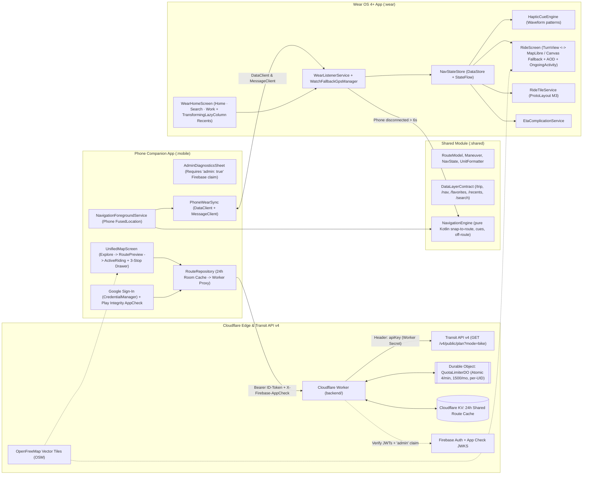
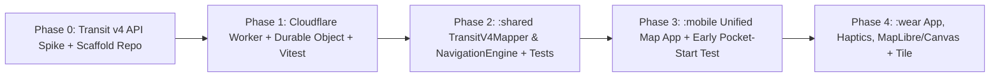

# Wear OS & Phone Companion Bike Navigator (Transit API v4 + Cloudflare Worker): Architecture Plan

## Goal
Build a Play Store-ready **Wear OS 4+ (API 33+) watch app + Android phone companion app + Cloudflare Worker backend** (`/Users/cmoronta/Desktop/transit`) that delivers **turn-by-turn bike directions** on your wrist using **haptic vibration cues**, an **Always-On Display (AOD) Ride screen** (with toggleable **Turn View** and **Map View**), a **Wear OS Tile**, and a **Watch Face Complication**.

---

## Finalized Architecture & Product Decisions

### 1. Security, Auth & Multi-User Quotas (Play Store Ready)
- **Zero API Keys on Any Device**: `TRANSIT_API_KEY` lives exclusively in a Cloudflare Worker Secret (`wrangler secret put TRANSIT_API_KEY`).
- **One-Tap Google Sign-In + Firebase App Check (Play Integrity)**:
  - Users sign in with **Google Sign-In only** (Android `CredentialManager` + Firebase Auth).
  - Every request to the Worker carries `Authorization: Bearer <Firebase-ID-Token>` and `X-Firebase-AppCheck: <Play-Integrity-JWT>`.
- **Admin Diagnostics Gated by Firebase Custom Claim (`admin: true`)**:
  - Your personal account receives the Firebase custom claim `{"admin": true}` (via a one-time Admin SDK script).
  - Both the Android phone app (before unlocking the hidden Admin Diagnostics sheet) and the Cloudflare Worker (`GET /v1/admin/quota`) verify `token.admin === true`. Regular Play Store users never see admin controls or internal quota metrics.
- **Strongly Consistent Quota Guard via Cloudflare Durable Objects + KV Edge Cache**:
  - **Cloudflare Durable Object (`QuotaLimiterDO`)**: Solves KV's eventual-consistency race condition. Enforces atomic counters for:
    1. Upstream rate limit (**≤ 4 req/min** global token bucket).
    2. Global monthly cap (**1,480 / 1,500 calls/month** on the free tier; configurable via env var when upgraded to a partner plan).
    3. Per-user daily/monthly fairness cap (`user:<uid>`) so no single public user can exhaust the shared quota.
  - **Cloudflare KV (`ROUTE_KV`)**: Used strictly for the **24-hour edge route cache** (`route:v4:<fromGrid100m>:<toGrid100m>:<profile>`). Because KV is shared globally across all users in Atlanta, popular BeltLine and Midtown routes cached by one rider serve subsequent riders with **0 Transit API calls**.

### 2. Transit API v4 (`/v4/public/plan`) & Quota-Saving Route Selection
- **Exclusively Transit API v4**:
  - Endpoint: **`GET https://external.transitapp.com/v4/public/plan`**
  - Core parameters: `mode=bike`, `from_lat`, `from_lon`, `to_lat`, `to_lon`, `locale` (plus future-ready support for `secondary_mode_legs=first_and_last_legs` and `sharing_system_type=docked_bikeshare` when you add multimodal/bikeshare later).
  - Header: `apiKey: <TRANSIT_API_KEY>` injected by the Cloudflare Worker.
- **Adaptive Route Ranking & Quota-Saving "More Routes" Flow**:
  1. **Phase 0 Live v4 Spike (`backend/scripts/spike-transit-v4.ts`)**: We make a single live call to `/v4/public/plan?mode=bike` for an Atlanta Midtown → Ponce City Market trip and save the exact v4 JSON response to `shared/src/test/resources/plan_v4_atlanta_bike.json`.
  2. **Safest Route Selected First**:
     - When `legs[].steps[]` include bike-infrastructure / `cycleway` tags, we compute the exact **`% protected path`** (protected distance ÷ total distance) and preselect the highest-% route as **`Safest · Default ★`**.
     - If step-level infrastructure tags are omitted in a region, we rank using Transit v4's safety-first default ordering and label the primary route **`Safest · Default ★`**.
  3. **Lazy `+ More routes` Button**: Picking a destination makes **only 1 API call**. If only 1 route comes back and alternative profiles are supported, the drawer shows a **`+ More routes`** pill that fetches alternatives only when tapped.

### 3. Watch Map Strategy: MapLibre Prototype + Lightweight Canvas Fallback
- We define a clean composable abstraction `WatchRouteMap(...)` in `:wear` with two implementations selectable at runtime:
  1. **`MapLibreWatchMap`**: Full OpenFreeMap vector street map (`org.maplibre.gl:android-sdk`) with pan, crown zoom (`onRotaryScrollEvent`), and ambient low-bit mode. Tested early on your physical Wear OS watch.
  2. **`CanvasVectorRouteMap` (Built-In Fallback)**: Pure Jetpack Compose `Canvas` renderer that draws the decoded route polyline, upcoming turn highlight, rider heading cone, cardinal compass ring, and street name labels at 60 fps with **zero tile downloads and minimal battery/RAM impact**. Used automatically in low-battery/offline states or if MapLibre feels heavy on your watch.

### 4. GPS Strategy & Early Risk Prototyping
- **Phone GPS Primary → Watch GPS Autonomous Fallback**:
  - Phone `FusedLocationProviderClient` drives `:shared`'s `NavigationEngine` while Bluetooth is connected.
  - Because the full `RouteModel` is synced to the watch at ride start (`/nav/route`), if the phone disconnects for > 6 s, the watch activates its own `FusedLocationProviderClient` and runs `NavigationEngine` locally to keep firing turn haptics along the synced route (while disconnected from the phone, the watch follows the cached route and shows a compass bearing if off-route, since only the phone talks to the backend for reroutes).
- **Week-1 Prototype of Pocket Start**: We immediately test starting `NavigationForegroundService` on your physical Android phone from the watch Tile with `ACCESS_BACKGROUND_LOCATION` granted. If the OEM battery saver blocks background FGS start while locked, the watch seamlessly starts navigation using its own GPS until the phone wakes.

### 5. System-Defined Material You Dynamic Color Palette (Phone & Watch)
- **Phone (`:mobile`)**: Uses Android's native Material You wallpaper extraction via `dynamicDarkColorScheme(context)` and `dynamicLightColorScheme(context)` (automatically following `isSystemInDarkTheme()`). All UI elements — the floating `SearchBar`, filter chips, 3-stop `BottomSheetScaffold`, route cards, turn banners, and even the active route polyline & rider puck on the MapLibre canvas — pull their colors dynamically from `MaterialTheme.colorScheme` (`primary`, `onPrimary`, `primaryContainer`, `secondaryContainer`, `surfaceContainerLow`, `surfaceContainerHigh`).
- **Watch (`:wear`)**: Uses `androidx.wear.compose.material3.dynamicColorScheme(context)` on Wear OS 4+, which extracts the user's active watch-face / system accent palette so `WearHomeScreen`, `RideScreen`, and `RideTileService` automatically match the user's watch theme (with a fallback M3 dark baseline if dynamic theming is disabled in system settings).

---

## High-Level Architecture



---

## Repository Structure (`/Users/cmoronta/Desktop/transit`)

```text
/Users/cmoronta/Desktop/transit/
├── docs/
│   ├── architecture_plan.md
│   ├── architecture_review.md
│   ├── phone_design_workshop.html
│   └── tile_design_workshop.html
├── backend/                   # Cloudflare Worker + Durable Object + KV (TypeScript + Wrangler + Vitest)
│   ├── wrangler.toml
│   ├── package.json
│   ├── scripts/
│   │   ├── spike-transit-v4.ts    # Phase 0 live test script for GET /v4/public/plan?mode=bike
│   │   └── set-admin-claim.ts     # Sets Firebase custom claim { admin: true } on your UID
│   ├── src/
│   │   ├── index.ts               # /v1/plan & /v1/admin/quota endpoints
│   │   ├── auth.ts                # Firebase Auth + App Check RS256 JWKS verifier + admin claim check
│   │   ├── quota-do.ts            # QuotaLimiterDO Durable Object (atomic rate limit, global & per-user quotas)
│   │   └── cache.ts               # ~100m grid normalizer + 24h KV route cache
│   └── test/
│       └── worker.test.ts
├── settings.gradle.kts
├── build.gradle.kts
├── gradle/libs.versions.toml
├── shared/                    # Kotlin library: models, DataLayerContract, PolylineDecoder, TransitV4Mapper, NavigationEngine
├── mobile/                    # Android phone companion app (minSdk 26, targetSdk 34)
└── wear/                      # Wear OS 4+ app (minSdk 33, targetSdk 34)
```

---

## Implementation Phases



1. **Phase 0 (`backend/scripts/spike-transit-v4.ts`)**: Run a single live call against `GET https://external.transitapp.com/v4/public/plan?mode=bike` for an Atlanta Midtown → Ponce City Market bike trip, save the real JSON fixture to `shared/src/test/resources/plan_v4_atlanta_bike.json`, and lock in the exact v4 step/polyline/cycleway fields.
2. **Phase 1 (`backend/`)**: Implement the Cloudflare Worker proxying `/v4/public/plan`, `QuotaLimiterDO` Durable Object, `ROUTE_KV` cache, and Firebase JWT verifier, verified with `npm test` (Vitest).
3. **Phase 2 (`:shared`)**: Implement `RouteModel`, `PolylineDecoder`, `TransitV4ResponseMapper`, `UnitFormatter`, `DataLayerContract`, and `NavigationEngine` + unit tests.
4. **Phase 3 (`:mobile`)**: Implement the single-pane `UnifiedMapScreen` (Explore, Route Preview with `Safest · Default ★` + `+ More routes`, Active Riding, 3-stop `Peek`/`Half`/`Full` drawer), Google Sign-In, `AdminDiagnosticsSheet` (gated by `admin: true` claim), and `NavigationForegroundService`. Test on your physical Android phone.
5. **Phase 4 (`:wear`)**: Implement `WearHomeScreen`, `RideScreen` (Turn View + `MapLibreWatchMap` & `CanvasVectorRouteMap` fallback + AOD + `OngoingActivity`), `HapticCueEngine`, `WatchFallbackGpsManager`, `RideTileService`, and `EtaComplicationService`. Test on your physical Wear OS watch.

---

## Verification Plan

### Automated Tests
- **Cloudflare Worker (`cd /Users/cmoronta/Desktop/transit/backend && npm test`)**:
  - Verifies Firebase Auth & App Check JWT validation, `admin: true` custom claim enforcement on `/v1/admin/quota`, KV cache hits (0 upstream calls), and `QuotaLimiterDO` atomic rate-limiting (4/min, per-UID daily limit, 1,500/month global cap).
- **Android Shared & App Modules (`./gradlew test`)**:
  - `:shared:test`: `PolylineDecoderTest`, `TransitV4ResponseMapperTest`, `NavigationEngineTest` (200 m / 50 m / Now cues, 15 s off-route trigger, 20 s reroute cooldown, phone→watch GPS handover), and `UnitFormatterTest`.
  - `:mobile:testDebugUnitTest` & `:wear:testDebugUnitTest`: Repository cache hits, lazy `+ More routes` fetching, and Data Layer serialization round-trips.

### Hardware Verification (Your Physical Phone + Watch)
1. Deploy the Worker (`npx wrangler deploy`) and set your Transit API key (`npx wrangler secret put TRANSIT_API_KEY`).
2. Install `:mobile` and `:wear` debug builds onto your physical Android phone and Wear OS watch via USB / Wireless Debugging in Android Studio.
3. Verify:
   - Starting a ride from the watch Tile while the phone is locked in your pocket.
   - Comparing `MapLibreWatchMap` vs `CanvasVectorRouteMap` smoothness and battery impact on your physical watch.
   - Turning off Bluetooth mid-ride to confirm the watch switches to its internal GPS within 6 seconds and continues delivering haptic turn cues.
