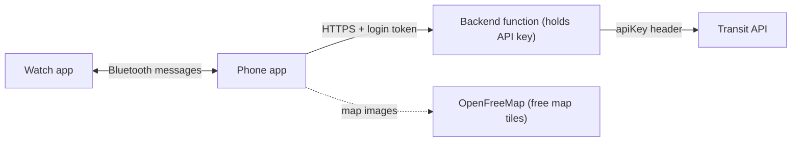

# Architecture Review: Transit Bike Navigator

Written for someone who knows TypeScript, Rails and AWS. Part 1 explains the pieces using things you already know. Part 2 is an honest review of what holds up and what doesn't.

---

## Part 1: The architecture in plain terms

### The big picture

There are four pieces of software:

| Piece | What it is | Closest thing you know |
|---|---|---|
| **Backend** (`backend/`) | A small TypeScript function that holds the Transit API key and forwards requests to Transit | A Lambda behind API Gateway |
| **Phone app** (`:mobile`) | The main app: map, search, route picker; it also tracks GPS during a ride | A React Native app plus a long-running worker |
| **Watch app** (`:wear`) | Shows turns, vibrates, has a tile and a watch-face widget | A second, tiny client app |
| **Shared code** (`:shared`) | Data models and the navigation math, used by both apps | A shared package in an npm workspace / monorepo |

### Backend: Cloudflare Worker ≈ Lambda

- **Cloudflare Worker** = a serverless TypeScript function, like Lambda + API Gateway in one. You write `export default { fetch(request, env) { ... } }`, and it runs in data centers worldwide with no cold starts. You'd feel at home: it's plain TypeScript with the standard `fetch` API.
- **Worker Secret** (`wrangler secret put TRANSIT_API_KEY`) = an encrypted environment variable, like a Lambda env var backed by Secrets Manager. The Transit key lives only here.
- **Cloudflare KV** = a global key-value store, roughly ElastiCache or a simple DynamoDB table. **Caveat:** it's *eventually consistent* (writes can take up to about 60 s to show up everywhere). That matters later.
- **`wrangler`** = the CLI used to deploy, like the SAM / Serverless Framework CLI.

What the backend does on each request:
1. Checks that the caller is really your app and a real user (see the next section).
2. Looks in the cache: if someone requested the same route in the last 24 h, it returns it without calling Transit.
3. Checks the monthly budget (1,500 calls) and the per-minute limit (5/min).
4. Calls Transit, caches the answer, and returns it.

### Auth: Firebase Auth + App Check ≈ Cognito + "is this really my app?"

Two separate questions:

- **"Who is this user?" → Firebase Auth** ≈ **Cognito** (or Devise in Rails). The user signs in with Google and the phone gets a short-lived **JWT**. The backend verifies the JWT signature against Google's public keys (JWKS), exactly like verifying a Cognito JWT in an API Gateway authorizer.
- **"Is this request coming from my real app, not `curl`?" → Firebase App Check (Play Integrity)**. AWS has no direct equivalent. Google's Play services on the phone attest that the request comes from your untampered app on a genuine device, and the phone sends a second short-lived JWT. This stops someone from pulling your backend URL out of the APK and draining your quota. Think of it as an API key that can't be copied.

Firebase isn't storing any data here. It's only used for these two token checks.

### Android vocabulary cheat sheet

| Android / Wear OS term | Think of it as |
|---|---|
| **Kotlin** | The language. Feels like TypeScript with stricter types. |
| **Jetpack Compose** | Declarative UI, very close to React components and state. |
| **Gradle modules** (`:shared`, `:mobile`, `:wear`) | Packages in a monorepo. |
| **Room** | A local SQLite database with an ORM, like ActiveRecord on the device. Used to cache routes. |
| **DataStore** | `localStorage`, for small settings. |
| **Foreground Service** | A long-running background worker (like a Sidekiq process). Android only lets it keep running if it shows a persistent notification. This is what tracks GPS while the phone is in your pocket. |
| **Wearable Data Layer** | The phone ↔ watch channel over Bluetooth. It has two flavors: |
| ↳ `DataClient` | **Synced state**, like a shared Redis key both devices see (e.g. "current route", "favorites"). |
| ↳ `MessageClient` | **Fire-and-forget events**, like an ActionCable broadcast (e.g. "vibrate: turn left now"). |
| **Tile** | A swipeable glance card on the watch, like a home-screen widget. |
| **Complication** | A tiny data slot on the watch face (e.g. "ETA 5:00"). |
| **Ongoing Activity** | Keeps the ride screen pinned, like iOS Live Activities. |
| **Ambient mode / AOD** | The dim always-on screen state. |
| **MapLibre + OpenFreeMap** | Open-source map rendering (like Mapbox GL) + free map tile hosting. No API key. |

### How a ride works, end to end

1. You pick **Ponce City Market** on the phone (or tap Home on the watch tile).
2. The phone sends `GET /v1/plan?from=...&to=...` to the backend with its two tokens.
3. The backend verifies the tokens, checks cache and quota, calls Transit and returns 2–3 route options.
4. You pick a route (the safest is preselected), and the phone sends the whole route to the watch once.
5. During the ride, the **phone** reads GPS every second and runs the navigation math ("you're 50 m from the next turn"). When a turn is coming up, it sends a tiny event to the watch, and the watch vibrates.
6. If the watch loses its Bluetooth connection, the watch already has the route, so it switches on its own GPS and runs the same navigation math itself. That's why the math lives in `:shared`.

**The key cost-saving idea:** one API call per trip. All turn-by-turn work happens on the device using GPS against the saved route. Nothing is polled.

---

## Part 2: Does it make sense? Honest review

**Overall: the core shape is sound.** The navigation design holds up: fetch once, navigate locally, phone does the heavy lifting, watch is the display plus fallback, shared math. Keeping the key on a server is also right. But reviewing it with fresh eyes, there are **4 real problems** in the plan, mostly introduced during the design iterations, and **3 risks** to test early.

### Real problems

> [!WARNING]
> **1. "% protected bike path" isn't confirmed to exist in the API data.**
> The route picker sorts routes by "% protected" and preselects the safest. But the standard OpenTripPlanner response doesn't clearly say whether each street segment is a protected lane, a painted lane, or a shared road. We haven't seen a real Transit response yet, so this headline feature rests on an assumption, and the same goes for the elevation numbers in the mockups.
> **Fix:** make the Phase 0 test call first. If the data isn't there, fall back to labels from Transit's own optimization modes ("Safest", "Fastest", "Flattest") instead of a percentage.

> [!WARNING]
> **2. Alternative routes may triple API usage.**
> If Transit returns only one bike route per request, then getting "Safest / Fastest / Quietest" means **three calls per destination** (one per optimization mode). Combined with previewing several destinations, that eats the 1,500/month budget about 3× faster.
> **Fix:** confirm in Phase 0 whether one call returns several itineraries. If not, fetch the safest route by default and load alternatives only when the user taps "More routes".

> [!WARNING]
> **3. KV is the wrong store for the quota counters.**
> Because KV is eventually consistent and allows about 1 write/second per key, two requests at once can both read "1,499" and both go through. It's like using a cache for a bank balance.
> **Fix:** use a **Durable Object** for the counters (Cloudflare's single-instance stateful object, which gives strongly consistent counting) and keep KV only for the route cache, where slight staleness is fine. Alternatively, since you know AWS: **DynamoDB atomic counters** with a conditional write handle this well.

> [!CAUTION]
> **4. The free tier is shared by everyone who uses the app.**
> The plan both allowlists specific user IDs (implying it's just you) and talks about regular users versus you as admin (implying other people). If other people use it, all of them share one 1,500-calls/month budget, which runs out quickly, and redistributing Transit data to the public may need a partner plan under Transit's terms.
> **This is the most important question to answer** (see below).

### Risks to prototype early (they may work, but are unproven)

1. **Starting a ride from the watch while the phone is locked in your pocket.** Android 12+ restricts apps from starting GPS tracking from the background. The plan relies on the "Allow all the time" location permission to get around this. It's likely fine for a sideloaded personal app, but should be tested in the first week, not the last. If it fails, the watch can use its own GPS for that ride.
2. **A full interactive map on the watch.** MapLibre on a watch is heavy (memory, battery), and map images load slowly over the Bluetooth link. A cheaper fallback is to draw just the route line and your position on a plain background, with no street map.
3. **Rerouting when the phone is disconnected.** The watch has no credentials to call the backend, so in watch-only mode it can follow the saved route but **can't reroute**. That's an acceptable limitation, but it should be stated explicitly. Today the compass fallback covers it.

### Things that are fine (no change needed)

- Phone GPS as primary, watch as fallback, with the math shared. ✅
- Tiles show glanceable data; the full Ride screen + vibrations handle real navigation. ✅
- A 24 h route cache on both the phone and the server. ✅
- One unified map screen with a bottom sheet, and admin tools hidden. ✅
- Cost: Cloudflare's free tier allows 100k requests/day, and Firebase Auth is free, so realistically $0/month. ✅

### Simplification worth considering

You'd be juggling **three vendors** (Cloudflare, Firebase/Google and Transit) on top of learning Android. Two options:

| Option | Backend | Auth | Pros | Cons |
|---|---|---|---|---|
| **A. As planned** | Cloudflare Worker + KV + Durable Object | Firebase Auth + App Check | $0, fast, TypeScript | New platform to learn |
| **B. Your stack** | AWS Lambda + API Gateway + DynamoDB | Firebase App Check (+ Google sign-in), verified in Lambda | You already know it; DynamoDB counters are a clean fit | Slightly more setup; Lambda cold starts (irrelevant at this scale) |

App Check works with any backend, since it's just a JWT to verify, so choosing AWS doesn't lose the "only my app can call this" protection. **If this is a personal app**, B is probably the better choice, because the only genuinely new thing to learn is Android.

---

## Key question before building

**Is this app just for you, or for other people too?**

- **Just you (or a few friends):** keep the user allowlist, free tier is fine, sideload the APKs, and Option B (AWS) is the simplest.
- **Public (Play Store):** you'll need a paid or partner Transit plan, per-user quotas, a Play Store background-location justification, and the admin sheet should be gated by a server-side admin role rather than just a debug build.
